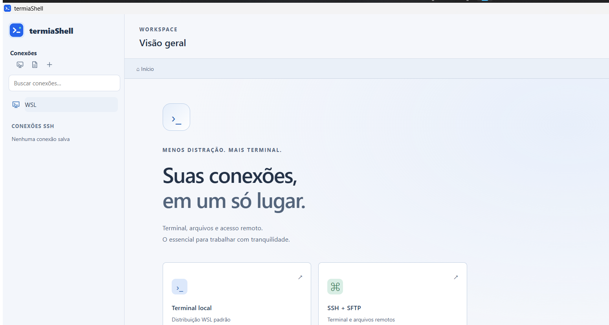

# termiaShell



Terminal desktop em Go com abas, WSL, SSH/SFTP e navegador gráfico de arquivos. Interface local, sem instalador, Node/npm, CDN ou telemetria. A estrutura compartilhada também inclui PTY e arquivos POSIX para Linux.

## Windows

Use `dist/termiaShell.exe` ou extraia `dist/termiaShell-Windows-x64.zip` numa pasta gravável. Go só é necessário para compilar. A execução requer WebView2 já existente; WSL só é necessário para sessões WSL. Nenhum componente do sistema será instalado.

```powershell
powershell -NoProfile -ExecutionPolicy Bypass -File .\scripts\build.ps1
.\dist\termiaShell.exe
```

Dados ficam em `data` ao lado do executável. Para outro caminho, use `termiaShell.exe --data-dir C:\pasta\dados`. Duas instâncias não podem compartilhar a mesma pasta. Falhas de inicialização do aplicativo podem gerar `startup-error.txt` ao lado do executável. Bloqueios anteriores à execução pelo Controle de Aplicativo do Windows não são contornados.

## Uso

- **WSL:** escolha uma distribuição existente. Terminal real via ConPTY e arquivos por UNC, sem alterar configuração da distribuição.
- **SSH:** informe host, porta e usuário; use senha ou chave privada com passphrase. Compare a fingerprint antes de confiar. Chave alterada bloqueia a conexão.
- **Arquivos:** duplo clique em pasta navega; em arquivo, abre diálogo de download. Barra superior permite upload, nova pasta e atualização. Ações por item permitem renomear e excluir item vazio.
- **Atalhos:** Ctrl+Shift+T cria sessão, Ctrl+Tab alterna abas, Ctrl+Shift+W fecha, Ctrl+Shift+C/V copia/cola. Colagem multilinha pede confirmação.
- **Tema:** abra a engrenagem de Preferências e escolha **Claro, Escuro ou Sistema**. Sistema acompanha o SO automaticamente; as opções fixas mantêm a escolha. A preferência é salva localmente e também se aplica aos terminais abertos.

Senhas e passphrases não são salvas. Caminhos de chaves privadas são salvos nos perfis. Arquivos existentes não são sobrescritos: escolha outro nome. Não há acompanhamento de `cd`, cópia recursiva, seguir links simbólicos, túneis ou MFA interativo.

## Desenvolvimento local

Módulos, caches e temporários ficam em `.local` no projeto. O build exige `wv2runtime.error` para impedir instalação automática do WebView2. Assets estão embutidos no executável. Não use instalação global de ferramentas.

```powershell
powershell -NoProfile -ExecutionPolicy Bypass -File .\scripts\test.ps1
powershell -NoProfile -ExecutionPolicy Bypass -File .\scripts\security.ps1 -AuditDependencies
powershell -NoProfile -ExecutionPolicy Bypass -File .\scripts\package.ps1
powershell -NoProfile -ExecutionPolicy Bypass -File .\scripts\clean.ps1
```

A limpeza remove apenas artefatos regeneráveis conhecidos. Preserva código, dados e `.local/gomodcache` para recompilar sem baixar novamente os módulos. O próximo build recria seu cache local. Testes do frontend rodam em Goja pelo próprio `go test`, sem Node. A auditoria OSV é opcional, usa rede para enviar somente nomes/versões de dependências e salva o relatório em `security/dependencies-osv.json`.

Licenças e hashes ficam em `third_party`; `scripts/licenses.ps1` regenera o inventário a partir do cache local. O pacote não inclui `.local` ou dados do usuário.

## Linux e testes

`sh scripts/build.sh` compila em ambiente com Go, compilador e GTK/WebKitGTK compatíveis já existentes. Se necessário e compatível, informe `TERMIASHELL_EXTRA_TAGS=webkit2_41`. Nenhum pacote nativo será instalado. PTY, arquivos POSIX, SSH/SFTP e testes internos já foram executados no Ubuntu WSL; o desktop Linux ainda requer validação própria.

Testes SSH automatizados usam servidor Go temporário em loopback. Roteiro opcional para OpenSSH em container: `tests/integration/ssh/README.md`, somente com runtime já disponível no WSL.

Consulte [SDD.md](SDD.md) para arquitetura, [VALIDATION.md](VALIDATION.md) para validação funcional e [SECURITY.md](SECURITY.md) para testes e auditoria de segurança.
